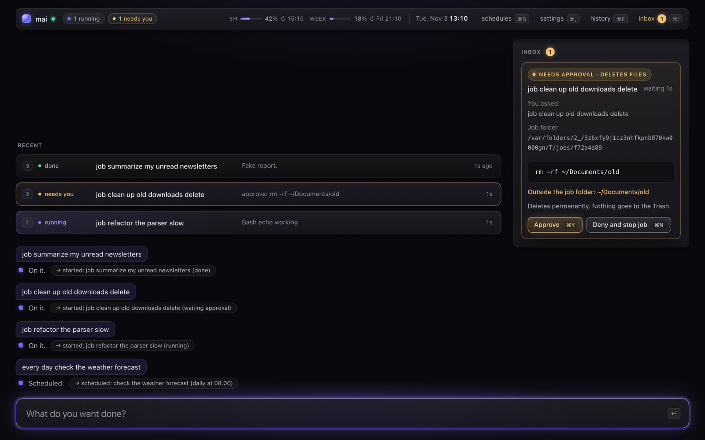
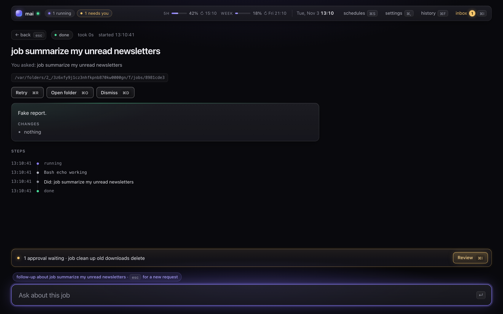
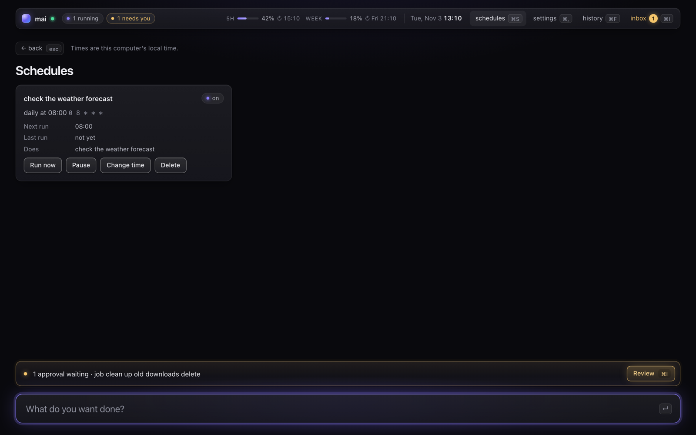
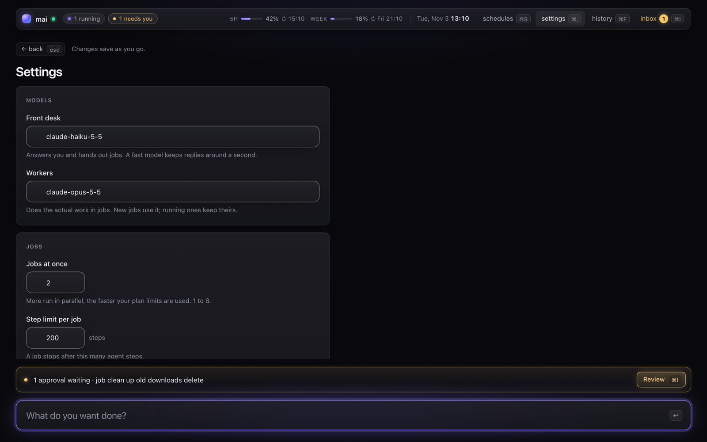

<div align="center">

# mai

**A personal AI shell: type what you want done, and background Claude agents do it.**

[](https://github.com/romanzdk/mai/actions/workflows/ci.yml)
[](LICENSE)




</div>

> [!WARNING]
> **This project is not actively developed.** I started mai as a proof of concept for an
> "AI operating system" — one place where you ask for things and agents get them done — and
> then stopped working on it. The code works and the tests pass, but expect rough edges, no
> releases and no support. Feel free to fork it, learn from it or build on it.

## What is it?

mai is a desktop app that sits full-screen on top of your normal OS (macOS or Ubuntu). It is
not a kernel or a Linux distro — it is a shell in the "one box you talk to" sense.

1. You type a request.
2. A fast **front desk** model (Claude Haiku) answers right away, or decides the request is
   real work and hands it off.
3. **Workers** (Claude Opus, via the Claude Agent SDK) run the job in the background with
   shell, file and browser access — two at a time by default.
4. Every job ends with a **short report**: what was done and what changed.
5. Anything risky — deleting files outside the job folder, `sudo`, `git push`, web actions
   that buy or send something — **pauses and waits for your approval**.

## Features

- **Front desk + background workers** — quick answers stay quick; long tasks don't block you.
- **Approval cards** — risky steps stop and show you the exact command, why it is risky, and
  what you originally asked for.
- **Job board and reports** — every job has a status, a step log, a final report, and
  Retry / Cancel / Dismiss / Open folder actions.
- **Follow-ups** — open a job and ask about it; the desk gets that job as context.
- **Git-aware jobs** — work inside a git repo happens on its own `mai/<id>` branch in a
  worktree. Nothing is ever pushed for you.
- **Browser tasks** — workers get a Playwright-driven browser through MCP.
- **Schedules** — "every day check the weather forecast" becomes a cron schedule you can run
  now, pause, retime or delete.
- **Memory** — the desk and workers read personal context notes from `~/context`.
- **claude.ai connectors** — workers can use your connectors; write actions need approval.
- **Spending guards** — plan usage in the top bar; new jobs are held near the plan limit.
- **History search, inbox, notifications, global hotkey, tray icon, start at login.**
- **Keyboard first** — almost every action has a shortcut.

## Screenshots

> The screenshots below come from a demo run with the built-in fake agent
> (`MAI_FAKE_AGENT=1`), so the job texts and reports are placeholders.

### Home: conversation, job board and inbox


The main screen. The top bar shows running jobs, jobs that need you, your 5-hour and weekly
plan usage, and the clock. The middle shows recent jobs with their status (done, needs you,
running), with your conversation with the front desk below. The inbox on the right holds an
approval card: a job wants to run `rm -rf` on a folder outside its own job folder, so it
stops and waits for **Approve** (`⌘Y`) or **Deny and stop job** (`⌘N`).

### Job view: report and steps



Opening a job shows what you asked, the job folder, the final report with a list of changes,
and a timeline of every step the worker took. The input box switches to follow-up mode, so
anything you type is a question about this job.

### Schedules



Recurring jobs made by just asking ("every day …"). Each card shows the plain-language time,
the cron expression, the next and last run, and buttons to run now, pause, change the time or
delete.

### Settings



Pick the front desk and worker models, how many jobs run at once, step limits per job and
more. Changes save as you go and are stored in the daemon's SQLite database.

## How it works

```
┌──────────────── Tauri 2 window (Rust host + React 19 UI) ────────────────┐
│  tray · global hotkey · spawns the daemon · passes {url, token} to UI    │
└───────────────────────────────┬──────────────────────────────────────────┘
                                │ WebSocket on 127.0.0.1 (per-session token)
┌───────────────────────────────▼──────────────────────────────────────────┐
│  Node 24 daemon                                                          │
│  input → front desk (Haiku, streamed) → job scheduler (max N parallel)   │
│        → workers (Opus, policy hook, Playwright MCP) → report            │
│  append-only SQLite event log, replayed to the UI on connect             │
└──────────────────────────────────────────────────────────────────────────┘
```

| Path                | What                                                         |
| ------------------- | ------------------------------------------------------------ |
| `apps/shell`        | Tauri 2 host (Rust) + React UI                               |
| `apps/daemon`       | Node daemon: WebSocket server, job queue, SQLite event log   |
| `packages/agent`    | Front desk, workers, reports and approval rules (Agent SDK)  |
| `packages/protocol` | Versioned JSON messages shared by the UI and the daemon      |
| `docs/SPEC.md`      | The original product spec (working name "Helm")              |
| `docs/DECISIONS.md` | Log of design decisions and why they were made               |

All model calls go through
[`@anthropic-ai/claude-agent-sdk`](https://www.npmjs.com/package/@anthropic-ai/claude-agent-sdk)
using your own Claude Code login. mai never reads, stores or proxies your OAuth tokens.

## Getting started

### Requirements

- macOS or Ubuntu
- [Rust](https://rustup.rs) and [pnpm](https://pnpm.io)
- Node.js ≥ 24 (only to run pnpm — the daemon ships with its own pinned Node binary)
- A signed-in [Claude Code](https://code.claude.com) (`claude login`) with a Claude
  subscription
- On Ubuntu: the [Tauri system packages](https://v2.tauri.app/start/prerequisites/#linux)

### Install

```sh
git clone https://github.com/romanzdk/mai.git
cd mai
pnpm install
pnpm app:install
```

This builds the app, installs it for your user (`~/Applications/mai.app` on macOS,
`~/.local/bin/mai.AppImage` plus a menu entry on Linux) and starts it. On first start mai
registers itself to start at login (you can turn this off in Settings) and downloads the
browser used for web tasks. Run the same command again to update.

### Use

- `Cmd/Ctrl+Shift+Space` shows or hides the window.
- The tray icon has Show/Hide and Quit.
- Jobs work in `~/mai/jobs/<id>` unless you name a project folder.

### Develop

```sh
pnpm install
pnpm dev          # builds the daemon and opens the Tauri window
```

Run without spending any tokens by starting the daemon with `MAI_FAKE_AGENT=1`.

| Variable           | Meaning                                                   |
| ------------------ | --------------------------------------------------------- |
| `MAI_TOKEN`        | WebSocket token (required; the Tauri host generates one)  |
| `MAI_PORT`         | Daemon port                                               |
| `MAI_DATA_DIR`     | Where mai keeps its data                                  |
| `MAI_DB`           | SQLite path (`:memory:` works)                            |
| `MAI_FAKE_AGENT=1` | Use a fake agent — no model calls                         |

`MAI_WORKSPACE`, `MAI_MAX_PARALLEL`, `MAI_API_KEY_MODE=1`, `MAI_BROWSER_HEADED=1` and
`MAI_CONTEXT_DIR` set defaults only; values saved on the Settings page win.

## Testing

```sh
pnpm lint
pnpm typecheck
pnpm test         # Vitest unit tests
pnpm test:e2e     # Playwright: real daemon (fake agent) + the React UI in Chromium
cd apps/shell/src-tauri && cargo test && cargo clippy --all-targets -- -D warnings
```

CI runs the same checks on macOS and Ubuntu.

## Contributing

The project is not actively maintained, so I can't promise to review or merge pull requests.
That said, fixes and ideas are welcome — see [CONTRIBUTING.md](CONTRIBUTING.md). Forking is
probably the best way to take it further.

## Security

mai runs AI agents that can execute shell commands, edit files and drive a browser on your
machine. The approval rules catch common risky actions, but they are not a sandbox. Only run
it on a machine and account you are comfortable letting an agent act on. If you find a
security problem, please open an issue (without exploit details) or contact me through my
GitHub profile.

## License

[MIT](LICENSE) © 2026 Roman Žydyk

mai is an independent project and is not affiliated with or endorsed by Anthropic.
